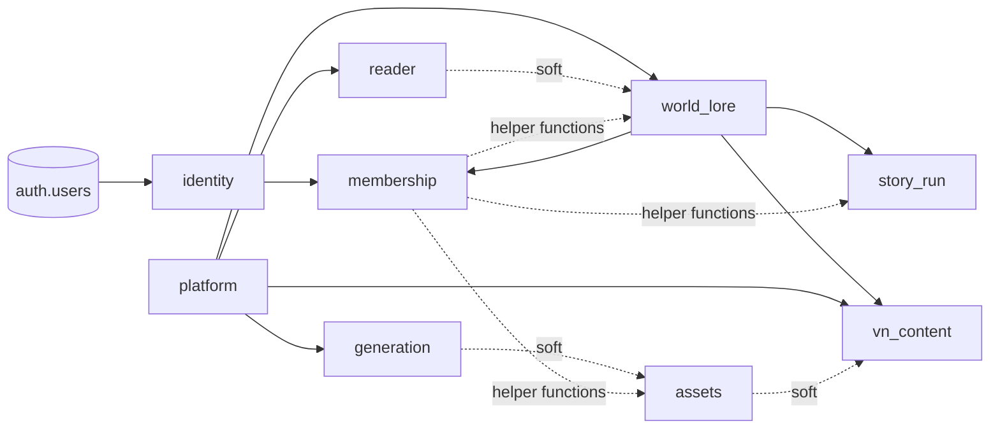

# Supabase database design plan

Status: Proposed. Branch: `feat/supabase-database`. Content-neutral: nothing here names a world, story or character.

## 1. Assumptions and open questions

- One Supabase project, one Postgres database, nine schemas (see 2). `public` holds nothing.
- **World-line (interpretation).** A world-line is a **branch of a world's lore**: a named line with its own draft, its own published versions and a recorded fork point (`forked_from_version_id`). Every world has a default line. Stories run on one line, pinned to one published version of it. *Alternative not taken:* a world-line as a timeline of events inside one story; that belongs in `story_run` as ordinary event data and needs no lore branching.
- Roles are per world (host, moderator, player). A player is also seated in a specific story.
- **Sign-in is SSO only, and SSO is how age is confirmed.** There is no password and no magic link. The identity provider (IdP) is an OIDC/SAML provider configured in Supabase Auth. First login runs an Auth hook that (1) rejects any identity with no pending invitation, and (2) records the IdP's adult assertion. The user never ticks a box.
- Open questions:
  1. Which IdP, and does it release an adult claim? Most consumer IdPs release no age claim. If yours does not, SSO proves who the person is, and the age confirmation is an attestation shown after SSO (see 4). The schema supports both through `age_source`.
  2. Is a read replica in the plan? The plan below works without one.
  3. Do hosts need to see who is hushed across all their worlds, or one world at a time? Assumed one world at a time.
  4. Is the Supabase plan one with PITR? Assumed yes for production.

## 2. Schema map

| Schema | Owns | Does not own | System of record | Readers | Writers | Exposed to API |
|---|---|---|---|---|---|---|
| `identity` | profiles, age confirmations, invitations | roles | profile, invitation | all members (own row), hosts (invitations they issued) | definer functions, Auth hook | yes (views only) |
| `membership` | roles, memberships, story seats, moderation, hushes, policy helpers | worlds, stories | who may do what | every policy (via functions) | host/mod through definer functions | yes (views only) |
| `world_lore` | worlds, lines, cards, secrets, versions | stories, chapters | lore | members (published), host (drafts, secrets) | host | yes |
| `story_run` | stories, turns, plot points, board, events | lore | story state | seated players, staff | players (own turns), host, server | yes |
| `reader` | chapters, chapter drafts and versions, reading progress | lore | chapter text | members | host (authoring), reader (progress) | yes |
| `vn_content` | VN, routes, scenes, scene revisions, VN versions | assets | VN script | members (published), host (drafts) | host | yes |
| `assets` | asset records, prompt specs, renders, feedback | job state | asset and dataset | members | host, server | yes |
| `generation` | jobs, stages, nodes, status history | assets | job state | requester, staff | server (service role) | read-only views |
| `platform` | settings, provider config, templates, audit, outbox, shared publish statuses | everything else | templates, audit | host (own world's), server | migration owner, host (overrides) | no (functions and views only) |

No merge or split is needed. `reader` and `vn_content` stay apart because their draft cycles and consumers differ.

**Cross-schema foreign keys** (all to a primary key; everything else is soft):

| From | To | Why integrity matters |
|---|---|---|
| `identity.profiles.user_id` | `auth.users(id)` | one profile per login |
| `membership.world_members.user_id` | `identity.profiles(user_id)` | no membership without a person |
| `membership.world_members.world_id` | `world_lore.worlds(id)` | no membership without a world |
| `story_run.stories.world_version_id` | `world_lore.world_versions(id)` | story pins a published version |
| `vn_content.vns.world_version_id` | `world_lore.world_versions(id)` | VN pins the lore it adapts |
| `world_lore.*`, `vn_content.*`, `reader.*` `.publish_status_key` | `platform.publish_statuses(key)` | one shared state vocabulary |
| `platform.template_pins.template_version_id` | `platform.template_versions(id)` | same schema, listed for completeness |
| `generation.jobs.workflow_template_version_id` | `platform.template_versions(id)` | a job records the exact graph it ran |



Solid arrows are foreign keys; dotted are soft references or function calls.

## 3. Normalised tables per schema

Conventions: every table has `id uuid primary key default gen_random_uuid()`, `created_at timestamptz not null default now()` and (mutable tables) `updated_at timestamptz not null default now()` kept by one `platform.touch()` trigger. Lookup tables key on `key text`. Append-only tables have no `updated_at`. All reach 3NF unless a denormalisation is justified inline.

### identity
| Table | Columns | Constraints and reason |
|---|---|---|
| `profiles` | `user_id uuid pk fk auth.users`, `display_name text not null`, `age_confirmed boolean not null default false`, `age_confirmed_at timestamptz`, `age_source text`, `disabled_at` | `check (age_confirmed = (age_confirmed_at is not null))`. Spec asks for boolean plus timestamp. |
| `age_confirmations` | `id`, `user_id fk`, `source_key fk age_sources`, `idp text`, `claim_name text`, `asserted_at timestamptz`, `evidence_hash bytea` | Append-only. Keeps *how* it was confirmed without storing the claim payload or a birth date. 3NF: source facts do not depend on the profile row. |
| `age_sources` (lookup) | `key`: `idp_claim`, `idp_attestation` | Add sources without a type migration. |
| `invitation_statuses` | key, label, is_terminal, sort_order | see 9 |
| `invitations` | `id`, `token_hash bytea not null unique`, `invitee_email citext not null`, `world_id uuid` (soft), `story_id uuid` (soft, nullable), `role_key text` (soft to `membership.roles`), `status_key fk`, `is_terminal bool`, `invited_by uuid fk profiles`, `expires_at timestamptz not null`, `accepted_by`, `accepted_at` | Token is stored hashed (sha-256 of 32 random bytes), shown once. Partial unique `(world_id, invitee_email) where not is_terminal` stops duplicate pending invites. `is_terminal` is copied from the lookup by trigger (justified denormalisation: it lets the partial index avoid a join). |
| `invitation_transitions`, `invitation_status_history` | see 9 | |

### membership
| Table | Columns | Constraints and reason |
|---|---|---|
| `roles` (lookup) | `key` (`host`,`moderator`,`player`), label, sort_order, `can_publish`, `can_moderate` | Capability flags live here, not in code. |
| `world_members` | `id`, `world_id fk`, `user_id fk`, `role_key fk roles`, `granted_by`, `granted_at`, `revoked_at` | unique `(world_id, user_id, role_key) where revoked_at is null`. A person may hold several roles in one world and different roles across worlds. Revocation is a timestamp, not a delete. |
| `story_seats` | `id`, `story_id` (soft), `world_id`, `user_id fk`, `joined_at`, `left_at` | `world_id` is a justified redundancy: policies need it without reading `story_run`. Written only by `membership.seat_player(story, user)`, which copies it from the story. Unique `(story_id, user_id) where left_at is null`. |
| `moderation_action_kinds` | lookup: `warn`, `hush`, `lift`, `remove_turn` | |
| `moderation_actions` | `id`, `world_id`, `story_id`, `target_user_id`, `actor_id`, `kind_key fk`, `target_ref uuid` (soft, e.g. a turn), `reason text not null`, `created_at` | Append-only. |
| `hushes` | `id`, `world_id`, `story_id`, `user_id`, `by_user_id`, `reason`, `starts_at`, `ends_at`, `lifted_at`, `lifted_by` | A hush is current when `lifted_at is null and now() between starts_at and coalesce(ends_at,'infinity')`. |

### world_lore
| Table | Columns | Constraints and reason |
|---|---|---|
| `worlds` | `id`, `slug text unique`, `title`, `created_by`, `archived_at` | |
| `world_lines` | `id`, `world_id fk`, `key text`, `title`, `forked_from_version_id fk world_versions null`, `head_version_id fk world_versions null`, `publish_status_key fk platform`, `draft_base_version_id` | unique `(world_id, key)`. Exactly one default line per world (partial unique `where is_default`). |
| `cards` | `id`, `world_id fk`, `kind text not null`, `slug text`, unique `(world_id, slug)` | Identity of a card across lines and versions. `kind` is free text per world (`character`, `place`, `rule`, …) so no kind list lives in the schema. |
| `card_drafts` | `line_id fk`, `card_id fk`, `title`, `body`, `meta jsonb`, `updated_by` | pk `(line_id, card_id)`. Mutable working copy, one per card per line. |
| `card_draft_parts` / `card_draft_secrets` | `(line_id, card_id, position, part_key, body)` | Parts and **host-only Secrets are separate tables**, so no view over parts can ever carry a secret column. |
| `card_revisions` | `id`, `card_id fk`, `world_id`, `rev_no int`, `title`, `body`, `meta jsonb`, `checksum`, unique `(card_id, rev_no)`, unique `(id, world_id)` | Immutable. Written only by publish. Revisions are shared between versions when a card did not change (structural sharing). |
| `card_revision_parts` | `(card_revision_id, position)` pk, `part_key`, `body` | `meta jsonb` on revisions is denormalised on purpose: free-form, read whole, never filtered. |
| `card_revision_secrets` | `(card_revision_id, position)` pk, `world_id`, `body` | composite fk `(card_revision_id, world_id)` → `card_revisions(id, world_id)` so `world_id` cannot drift. Host-only (5). |
| `world_versions` | `id`, `world_line_id fk`, `version_no`, `note`, `published_by`, `published_at`, `status_key fk platform` | Immutable content. Only `status_key` (published, retracted) may change, through the transition function. |
| `world_version_cards` | `(world_version_id, card_id)` pk, `card_revision_id fk` | The version's contents. |

### story_run
| Table | Columns | Notes |
|---|---|---|
| `story_statuses`, `story_transitions`, `story_status_history` | see 9 | |
| `stories` | `id`, `world_id`, `world_version_id fk world_lore` (immutable), `title`, `host_id`, `status_key fk`, `is_terminal` | `world_id` redundancy enforced by trigger comparing to the pinned version. |
| `turns` | `id`, `story_id fk`, `world_id`, `seq bigint`, `author_id`, `kind_key fk turn_kinds` (`player`,`host`,`system`), `body`, `meta jsonb`, `removed_at` | unique `(story_id, seq)`. Player turns are data only; nothing writes them into lore. |
| `plot_points` | `id`, `story_id fk`, `position`, `title`, `body`, `state_key fk` | Host-owned. |
| `board_items` | `id`, `story_id fk`, `kind`, `body`, `meta`, `created_by` | The shared board players see. |
| `events` | `id`, `story_id fk`, `world_id`, `seq`, `kind_key`, `payload jsonb`, `created_at` | Player-visible log. |
| `host_events` | same shape, host-only | **Separate table** from `events`, not a visibility flag, so a bad projection of `events` cannot leak host material. Secrets are referenced here by id, never copied into `events.payload` (writer function rejects payload keys that name secret ids). |

### reader
`chapters(id, world_id, world_line_id, slug, position, head_version_id, publish_status_key)`, `chapter_drafts(chapter_id pk, title, body, base_version_id)`, `chapter_versions(id, chapter_id, version_no, title, body, checksum, published_at, published_by, status_key)` (immutable body), `reading_progress(user_id, chapter_id, offset, updated_at)` with pk `(user_id, chapter_id)`. `world_line_id` and `world_id` are soft references.

### vn_content
| Table | Notes |
|---|---|
| `vn_tiers` (lookup) | size tiers from the adaptation skill, by key. |
| `vns` | `id`, `world_id`, `world_version_id fk`, `slug`, `title`, `tier_key fk`, `head_version_id`, `publish_status_key`. unique `(world_id, slug)`. |
| `vn_drafts` | `vn_id pk`, `manifest jsonb`, `base_version_id`. Manifest shape is validated against the pinned VN template. |
| `routes` | `id`, `vn_id`, `key`, `kind_key` (`common`,`branch`,`ending`), `position`. |
| `scenes` | `id`, `vn_id`, `route_id`, `key`, `position`. Identity only. |
| `scene_drafts` | `scene_id pk`, `title`, `lines jsonb`, `slides jsonb`. |
| `scene_revisions` | immutable: `id`, `scene_id`, `rev_no`, `title`, `lines jsonb`, `slides jsonb`, `checksum`. `lines` and `slides` are denormalised (justified): always read as a whole script, never queried per line. |
| `vn_versions` | `id`, `vn_id`, `version_no`, `manifest jsonb`, `published_at`, `status_key`. |
| `vn_version_scenes` | `(vn_version_id, scene_id)` pk, `scene_revision_id`, `route_id`, `position`. |

### assets
| Table | Notes |
|---|---|
| `asset_kinds` (lookup) | `sprite`, `cg`, `bg`. |
| `asset_statuses`, `asset_transitions`, `asset_status_history` | see 9 |
| `assets` | `id`, `world_id`, `vn_id` (soft, **null = shared pool**), `kind_key fk`, `name`, `status_key fk`, `current_spec_id`, `current_render_id`. Unique `(world_id, coalesce(vn_id, '00000000-…'), kind_key, name)`. |
| `asset_specs` | immutable prompt record: `id`, `asset_id`, `spec_no`, `positive text`, `negative text`, `seed bigint`, `steps`, `cfg numeric`, `sampler text`, `scheduler text`, `width`, `height`, `workflow_template_version_id` (soft). Sampler settings are columns, not jsonb, because the dataset compares them. |
| `renders` | `id`, `asset_id`, `spec_id fk`, `storage_path`, `job_id` (soft), `archived_at null`. A row with `archived_at` set is the dataset entry. |
| `feedback_choices` (lookup) | `better`, `keep`, `worse`. |
| `render_feedback` | `(render_id, tag)` pk, `choice_key fk`. One row per tag, so a tag is queryable. |

### generation
| Table | Notes |
|---|---|
| `job_statuses`, `job_transitions`, `job_status_history` | see 9 |
| `jobs` | `id`, `world_id`, `vn_id`, `asset_id` (soft), `requested_by`, `idempotency_key text`, `workflow_template_version_id fk platform`, `status_key fk`, `is_terminal`, `comfy_prompt_id text`, `queue_position int`, `error_code text`, `started_at`, `finished_at`. unique `(requested_by, idempotency_key)`. |
| `job_stages` | `(job_id, stage_key)` pk, `state_key fk stage_states`, `started_at`, `finished_at`. Stages: prepare, queue, render, save. |
| `job_nodes` | `(job_id, node_id)` pk, `title`, `state_key fk node_states` (`pending`,`active`,`done`,`cached`). Per-step sampler progress is broadcast, not stored (14). |

### platform
`table_settings(world_id, key, value jsonb)` pk `(world_id, key)`; `provider_configs(id, kind, name, base_url, secret_id uuid → vault.secrets, enabled)`; `publish_statuses`, `publish_transitions`, `publish_status_history`; `audit_log(id, at, actor_id, world_id, action, subject_kind, subject_id, detail jsonb)` partitioned by month, append-only; `outbox` (12); template tables (11).

**Soft references**

| Column | Target schema | Target entity |
|---|---|---|
| `invitations.world_id`, `story_id` | world_lore, story_run | world, story |
| `invitations.role_key` | membership | role |
| `story_seats.story_id` | story_run | story |
| `reader.chapters.world_id`, `world_line_id` | world_lore | world, line |
| `vn_content.vns.world_id` | world_lore | world (the pinned version carries the line) |
| `assets.assets.world_id`, `vn_id` | world_lore, vn_content | world, VN |
| `assets.asset_specs.workflow_template_version_id` | platform | template version |
| `assets.renders.job_id` | generation | job |
| `generation.jobs.world_id`, `vn_id`, `asset_id` | world_lore, vn_content, assets | world, VN, asset |
| `platform.audit_log.*`, `table_settings.world_id` | any | any |

## 4. Identity and authorisation

**Sign-in.** Auth config: email/password, magic link and phone are off; sign-ups off (`disable_signup = true`); only the SSO provider is on. Users are created only through the admin API, called by the server with the service role on behalf of an accepted invitation.

**Invitation flow**
1. Host calls `identity.create_invitation(world, email, role, ttl)` (definer; checks `membership.is_host`). It stores `sha256(token)`, never the token, and returns the token once. Default `expires_at = now() + 7 days`.
2. The server emails a link containing the token.
3. The invitee signs in through SSO. The **before-user-created Auth hook** looks up a pending, unexpired invitation for the verified IdP email; none means reject. It writes nothing else.
4. After login the app calls `identity.accept_invitation(token)` (definer, one transaction): `update … set status_key='accepted' where token_hash=… and status_key='pending' and expires_at>now() returning …` (single use by construction), creates the profile if absent, grants the membership row, writes history and audit.

**Age confirmation by SSO.** The Auth hook (or `accept_invitation`, whichever first sees the session) reads the IdP's adult assertion from the ID token claims, hashes the relevant claim, and inserts an `age_confirmations` row with `source_key = 'idp_claim'`; the profile gets `age_confirmed = true`, `age_confirmed_at = now()`. If the IdP releases no age claim, the person may not continue until the one-time attestation screen is submitted, which records `idp_attestation`. Every policy path that grants a role requires `age_confirmed`. The product stores no date of birth and no claim payload.

**Helper functions** (all `stable security definer set search_path = ''`, `revoke execute … from public, anon`, `grant execute … to authenticated, app_rw, app_ro`):

```sql
create function membership.has_world_role(p_world uuid, p_roles text[])
returns boolean language sql stable security definer set search_path = '' as $$
  select exists (
    select 1 from membership.world_members m
    join identity.profiles p on p.user_id = m.user_id
    where m.world_id = p_world and m.user_id = (select auth.uid())
      and m.revoked_at is null and m.role_key = any (p_roles)
      and p.age_confirmed and p.disabled_at is null);
$$;
-- is_host(w)      = has_world_role(w, '{host}')
-- is_staff(w)     = has_world_role(w, '{host,moderator}')
-- is_member(w)    = has_world_role(w, '{host,moderator,player}')
-- is_story_player(s), is_hushed(s): same pattern on story_seats / hushes
```

**Custom JWT claim?** No. A claim goes stale until the token refreshes, so a revoked moderator keeps power for up to an hour, and a person with different roles in many worlds does not fit in a claim. One indexed lookup per request is cheaper than that risk. Policies use `(select auth.uid())` so Postgres evaluates it once per statement.

**Role change or revocation.** `membership.revoke_role(...)` sets `revoked_at`. The next request fails the helper immediately. Existing access tokens and Realtime subscriptions: private Realtime channels re-check RLS on subscribe, and the server closes the host's active channels on revocation through the outbox. The audit log records the change.

**A different auth screen per role.** Host, moderator and player each get their own entry page (`/host/sign-in`, `/moderate/sign-in`, `/play/sign-in`) with its own copy, its own SSO button and its own redirect URL. The screen is a convenience and a smaller attack surface; it is never the authority.

| Decision | Choice |
|---|---|
| What the screen decides | Which invitation the person is redeeming and which app shell loads afterwards. Nothing about what they may do. |
| Authority | Still `membership.world_members`. A person who signs in on the host screen without an active `host` row gets the host shell refused and is sent to a screen for a role they hold. |
| Invitation link | The emailed link targets the screen of the invited `role_key`, so a moderator invitation lands on the moderator screen. |
| SSO client | One IdP client (one Supabase provider) with a per-role redirect URL allowlist. A separate IdP client per role is not worth it: it multiplies secrets and does not add authorisation. |
| After login | The shell calls `identity.enter_as(role_key, world_id)` (stable definer function). It returns the caller's worlds where they hold that role, or an error. The choice of role lives in client state only. |
| Why no role in the token | The reasoning above holds: policies re-check membership on every request, so a stale or tampered "acting role" cannot widen access. |
| Hosts | Hosts are first created by a platform admin invitation (bootstrap), then invite others. |
| Separate bundles | The moderator and player shells do not ship host editing code (Secrets editor, template editor), so a player's browser never even loads host-only screens. |

Test: sign in through the player screen with a host-only account; every host policy still passes only because of the host row, and the player shell shows only the worlds where the person is seated.

## 5. Row Level Security

All tables: `enable` and `force row level security`. `anon` and `public` get nothing. `service_role` bypasses RLS by Supabase design, so it is used only inside narrow definer functions and the generation worker, never from the browser.

Notation: S select, I insert, U update, D delete; "own" means the caller's rows; — means none. Anon and N (non-member) are always —. Service role: all, bypassing RLS.

| Table | Host | Moderator | Player | 
|---|---|---|---|
| identity.profiles | S own, U own display_name | S own | S own, U own display_name |
| identity.invitations | S issued | — | — |
| membership.world_members | S world | S world | S own |
| membership.moderation_actions | S | S, I (via function) | S own targeted |
| membership.hushes | S | S, I (function) | S own |
| world_lore.worlds, world_lines | S, U | S | S |
| world_lore.card_drafts, card_draft_parts | SIUD | — | — |
| world_lore.card_draft_secrets, card_revision_secrets | SIUD / S | — | — |
| world_lore.card_revisions, parts, world_versions, world_version_cards | S | S | S |
| story_run.stories | SIU | S | S seated |
| story_run.turns | S, I | S, U (remove) | S seated, I own, not hushed |
| story_run.events | S | S | S seated |
| story_run.host_events, plot_points | SIUD | — | — |
| story_run.board_items | SIUD | S | S seated |
| reader.chapters, chapter_versions | S | S | S |
| reader.chapter_drafts | SIUD | — | — |
| reader.reading_progress | — | — | SIU own |
| vn_content drafts (`vn_drafts`, `scene_drafts`) | SIUD | — | — |
| vn_content versions and revisions | S | S | S |
| assets.assets, specs, renders | SIU | S | S |
| assets.render_feedback | SIUD | S | — |
| generation.* | S (requested or world) | S | — |
| platform.table_settings | SIU | S | — |
| platform.template_* | S defaults, SIU own-world overrides | — | — |
| platform.provider_configs, audit_log, outbox | audit S (own world) | audit S | — |

Tables that are written only by definer functions (versions, revisions, history, audit, moderation) have **no** write policy for `authenticated` at all.

**Delicate table 1: host-only Secrets**

```sql
alter table world_lore.card_revision_secrets enable row level security;
alter table world_lore.card_revision_secrets force row level security;
create policy secrets_host_only on world_lore.card_revision_secrets
  for select to authenticated
  using ((select membership.is_host(world_id)));
-- no insert/update/delete policy: publish writes it as definer.
revoke all on world_lore.card_revision_secrets from authenticated;
grant select (card_revision_id, position, world_id, body)
  on world_lore.card_revision_secrets to authenticated;
```

Separation: Secrets live in their own tables (draft and revision), never as a column on `cards`, `card_revisions` or `events`; no player-facing view selects from them; the `events` writer rejects secret ids. Players have no policy that matches, so even a mistaken `grant select` returns zero rows.

**Delicate table 2: player turns**

```sql
create policy turns_read on story_run.turns for select to authenticated
  using ((select membership.is_story_player(story_id)) or (select membership.is_staff(world_id)));
create policy turns_write_own on story_run.turns for insert to authenticated
  with check (
    author_id = (select auth.uid()) and kind_key = 'player'
    and (select membership.is_story_player(story_id))
    and not (select membership.is_hushed(story_id))
    and (select story_run.accepts_turns(story_id)));   -- reads story_run only
create policy turns_moderate on story_run.turns for update to authenticated
  using ((select membership.is_staff(world_id)))
  with check ((select membership.is_staff(world_id)));   -- column grant: removed_at only
```

**Delicate table 3: memberships (no self-escalation)**

```sql
create policy members_read on membership.world_members for select to authenticated
  using (user_id = (select auth.uid()) or (select membership.is_host(world_id)));
-- no write policy. Writes go through membership.grant_role / revoke_role (definer):
--   host may grant moderator or player only; host role is created with the world;
--   the last host cannot be revoked; grantee must have age_confirmed.
```

**Revoking default privileges**

```sql
revoke all on schema public from public, anon;
do $$ declare s text; begin
  foreach s in array array['identity','membership','world_lore','story_run','reader',
                           'vn_content','assets','generation','platform'] loop
    execute format('revoke all on schema %I from public, anon', s);
    execute format('revoke all on all tables in schema %I from public, anon', s);
    execute format('revoke all on all functions in schema %I from public, anon', s);
    execute format('alter default privileges for role migration_owner in schema %I
                    revoke all on tables from public, anon, authenticated', s);
    execute format('alter default privileges for role migration_owner in schema %I
                    revoke execute on functions from public, anon', s);
  end loop; end $$;
-- every grant afterwards is explicit, per object, in the same migration that creates it.
```

Also: set the API `anon` role to the zero-privilege role; Storage and Realtime policies name `authenticated` explicitly.

## 6. Views

An honest limit first: a `security_invoker` view runs with the caller's rights, so `authenticated` must hold `select` on the base tables (with RLS). PostgREST will therefore list those tables too. We cannot hide them; we enforce instead that (a) base-table grants are column-limited, (b) RLS is tight, (c) the client code and a CI check use only `v_*` objects.

| Schema | View | Base | Purpose | Who | invoker | Materialized |
|---|---|---|---|---|---|---|
| world_lore | `v_world_line_current` | world_lines, world_versions | head published version per line | members | yes | no |
| world_lore | `v_card_current` | above + world_version_cards, card_revisions, cards | player-safe cards (no secrets) | members | yes | no |
| world_lore | `v_card_parts_current` | + card_revision_parts | parts for those cards | members | yes | no |
| world_lore | `v_card_secrets_current` | + card_revision_secrets | host view | host | yes | no |
| story_run | `v_story_summary` | stories, status lookup | list screen | seated, staff | yes | no |
| story_run | `v_turn_feed` | turns (not removed) | keyset feed | seated, staff | yes | no |
| reader | `v_chapter_current` | chapters, chapter_versions | published chapter | members | yes | no |
| vn_content | `v_vn_current`, `v_scene_current` | vns, versions, scenes | published script | members | yes | no |
| assets | `v_asset_list` | assets, renders | gallery list | members | yes | no |
| assets | `v_dataset_runs` | renders, specs, feedback | dataset gallery | members | yes | **mat. view** for dashboards only: refresh after archive via outbox worker, staleness up to 5 min; gallery itself reads the plain view |
| generation | `v_jobs_active`, `v_jobs_recent` | jobs, stages, nodes | queue panel | requester, staff | yes | no |
| platform | `v_effective_template` | see 11 | generation only | server | n/a (function) | no |

```sql
-- current published version
create view world_lore.v_world_line_current with (security_invoker = true) as
select wl.id as line_id, wl.world_id, wl.key, wv.id as version_id, wv.version_no, wv.published_at
from world_lore.world_lines wl
join world_lore.world_versions wv on wv.id = wl.head_version_id and wv.status_key = 'published';

-- player-safe cards: no secrets table is referenced anywhere
create view world_lore.v_card_current with (security_invoker = true) as
select c.world_id, cur.line_id, cur.version_id, c.id as card_id, c.kind, c.slug,
       r.title, r.body, r.meta
from world_lore.v_world_line_current cur
join world_lore.world_version_cards vc on vc.world_version_id = cur.version_id
join world_lore.card_revisions r on r.id = vc.card_revision_id
join world_lore.cards c on c.id = vc.card_id;
grant select on world_lore.v_card_current to authenticated;
```

## 7. Indexes

Hot queries first:

| # | Query |
|---|---|
| H1 | RLS: is user U a (role) member of world W (every request) |
| H2 | RLS: is user U seated in story S |
| H3 | Turn feed for a story, newest first, paged |
| H4 | Current published version and its cards for a line |
| H5 | Assets of a VN by kind and name; shared pool of a world |
| H6 | Active jobs for a world; recent jobs for a user |
| H7 | Dataset runs of an asset, newest first; filter by tag |
| H8 | Invitation by token hash; pending invites for a world |
| H9 | Effective template for (world, vn, kind) |
| H10 | Outbox rows not yet delivered |
| H11 | Chapters of a line in order |
| H12 | Audit log for a world, newest first |

| Index | Table | Columns | Type | Partial | Serves | Write cost |
|---|---|---|---|---|---|---|
| `world_members_lookup` | membership.world_members | `(user_id, world_id) include (role_key)` | btree | `where revoked_at is null` | H1 | low; changes only on role change |
| `story_seats_lookup` | story_seats | `(user_id, story_id)` | btree | `where left_at is null` | H2 | low |
| `hushes_active` | hushes | `(story_id, user_id)` | btree | `where lifted_at is null` | H2 | low |
| `turns_feed` | story_run.turns | `(story_id, seq desc)` | btree | `where removed_at is null` | H3 | one per turn |
| `world_version_cards_pk` | world_version_cards | `(world_version_id, card_id)` | pk | | H4 | at publish |
| `wvc_revision_fk` | same | `(card_revision_id)` | btree | | fk cover | at publish |
| `assets_vn_name` | assets.assets | `(vn_id, kind_key, name)` | unique | `where vn_id is not null` | H5 | low |
| `assets_shared_name` | assets.assets | `(world_id, kind_key, name)` | unique | `where vn_id is null` | H5 | low |
| `jobs_active` | generation.jobs | `(world_id, created_at desc)` | btree | `where not is_terminal` | H6 | each state move |
| `jobs_user_recent` | jobs | `(requested_by, created_at desc)` | btree | | H6 | per job |
| `renders_dataset` | assets.renders | `(asset_id, created_at desc, id)` | btree | `where archived_at is not null` | H7 | per archive |
| `feedback_tag` | render_feedback | `(tag, choice_key)` | btree | | H7 tag filter | per feedback |
| `invitations_token` | identity.invitations | `(token_hash)` | unique | | H8 | per invite |
| `invitations_pending` | invitations | `(world_id, invitee_email)` | unique | `where not is_terminal` | H8 | per invite |
| `pins_scope` | platform.template_pins | `(scope_type, coalesce(scope_id, '00000000-0000-0000-0000-000000000000'::uuid), kind_key)` | unique | | H9 | rare |
| `outbox_pending` | platform.outbox | `(id)` | btree | `where delivered_at is null` | H10 | per event, trimmed on delivery |
| `chapters_line` | reader.chapters | `(world_line_id, position)` | btree | | H11 | rare |
| `audit_world_at` | platform.audit_log | `(world_id, at desc)` per partition | btree | | H12 | one per event |

Foreign-key columns not listed above get a plain btree only where the parent is deleted or joined (checked by the privilege-and-index test in 18).

Keyset pagination (H3):

```sql
select id, seq, author_id, body from story_run.v_turn_feed
where story_id = $1 and seq < $2      -- $2 = last seq seen; first page uses bigint max
order by seq desc limit 50;
```

**Deliberately not created:** GIN on `meta`, `payload`, `manifest`, `lines`, `slides` (never filtered by content; add only when a named query appears); trigram on prompts (the gallery filters inside one asset's runs, a few dozen rows); an index on every `status_key` (low cardinality, the partial indexes above cover the queries); indexes on `created_at` alone; an index on `audit_log.actor_id` (no query yet).

## 8. Connection model

| Role | Login | Schemas / objects | Grants |
|---|---|---|---|
| `migration_owner` | via direct connection only, CI | owns every object | everything; never used by the app |
| `app_rw` | yes, transaction pooler | exposed views, definer functions; no direct table DML except `generation` and `platform.outbox` through functions | member of `authenticated` with `set role` |
| `app_ro` | yes, transaction pooler (replica endpoint if any) | select on views and read tables only | `default_transaction_read_only = on`; zero `insert/update/delete/truncate`, zero execute on mutating functions |
| `authenticated` | no login; used by PostgREST/Realtime/Storage and by `set local role` | per-schema grants in 5 | RLS applies |
| `service_role` | server and Edge Functions only, never browser | bypasses RLS | used in definer functions and the generation worker |
| `anon` | none | nothing | zero on every object |

```sql
create role app_rw login noinherit connection limit 40;
create role app_ro login noinherit connection limit 15;
grant authenticated to app_rw, app_ro;
alter role app_ro set default_transaction_read_only = on;
alter role app_rw set statement_timeout = '15s';
alter role app_ro set statement_timeout = '5s';
alter role authenticated set statement_timeout = '8s';
alter role app_rw set idle_in_transaction_session_timeout = '15s';
alter role app_ro set idle_in_transaction_session_timeout = '15s';
alter role app_rw set lock_timeout = '3s';
-- per schema, explicit (example):
grant usage on schema assets to authenticated, app_rw, app_ro;
grant select on assets.v_asset_list, assets.v_dataset_runs to authenticated, app_ro;
-- app_ro: no table-level DML grants exist, so a stray grant is caught by the test in 18.
```

User-initiated work runs as the user: the server verifies the JWT, then in the transaction runs `select set_config('request.jwt.claims', $1, true); set local role authenticated;`. The same RLS policies apply to the browser and the server, so there is one authorisation path. Background work (generation worker) calls definer functions as `service_role`.

**Pooling.** Both classes use the transaction-mode pooler (port 6543): disable prepared statements in the driver, no session state across statements. Pool sizes: `app_rw` 10 per server instance (cap 40 by role limit); `app_ro` 5 per instance (cap 15). Browsers never connect directly.

**Read-your-writes.** Needed after publish, after accept-invitation, after granting or revoking a role, and after a job is created. The client sends the `version_no` or `id` it just received (`?min_version=`); the server reads from `app_ro`, and if the head is behind it re-reads from `app_rw`. Everything else (gallery, reader, dashboards, export) tolerates lag.

**No replica.** `app_ro` points at the primary. It keeps its protections (read-only, 5 s timeout, 15-connection cap) so reads cannot starve writes, and the routing code is unchanged, so adding a replica later is a connection-string change.

## 9. Status tables

Pattern (identical for each machine):

```sql
create table generation.job_statuses (
  key text primary key, label text not null, is_terminal boolean not null default false,
  sort_order int not null, created_at timestamptz not null default now());
create table generation.job_transitions (
  from_key text not null references generation.job_statuses, to_key text not null references generation.job_statuses,
  actor text not null check (actor in ('system','host','moderator','player')),
  primary key (from_key, to_key, actor));
create table generation.job_status_history (
  id uuid primary key default gen_random_uuid(), entity_id uuid not null,
  from_key text, to_key text not null, actor_id uuid, reason text, at timestamptz not null default now());

create function platform.enforce_transition() returns trigger
language plpgsql security definer set search_path = '' as $$
declare t_schema text := tg_argv[0]; t_prefix text := tg_argv[1]; ok boolean; actor text;
begin
  if new.status_key is not distinct from old.status_key then return new; end if;
  actor := case when current_user in ('app_rw','service_role') and (select auth.uid()) is null then 'system'
                when (select membership.is_host(new.world_id)) then 'host'
                when (select membership.is_staff(new.world_id)) then 'moderator'
                else 'player' end;
  execute format('select exists (select 1 from %I.%I where from_key=$1 and to_key=$2 and actor=$3)',
                 t_schema, t_prefix || '_transitions') into ok using old.status_key, new.status_key, actor;
  if not ok then raise exception 'transition % -> % not allowed for %', old.status_key, new.status_key, actor
    using errcode = '23514'; end if;
  new.is_terminal := (select is_terminal from ...status table...);   -- via format, same pattern
  execute format('insert into %I.%I (entity_id, from_key, to_key, actor_id) values ($1,$2,$3,$4)',
                 t_schema, t_prefix || '_status_history') using new.id, old.status_key, new.status_key, (select auth.uid());
  return new;
end $$;

create trigger jobs_transition before update of status_key on generation.jobs
  for each row execute function platform.enforce_transition('generation', 'job');
```

History and transitions tables have `update, delete, truncate` revoked and a trigger refusing them. The status stays on the entity row for fast reads.

| Machine | States (terminal marked *) | Allowed moves (actor) |
|---|---|---|
| publish (`platform`, shared) | draft, ready, published, retracted* | draft→ready (host), ready→draft (host), ready→published (system, via publish function), published→retracted (host) |
| generation job | queued, running, saving, done*, error*, cancelled* | queued→running, running→saving, saving→done, running→error, saving→error (system); queued/running→cancelled (host, system) |
| asset | pending, rendering, rendered, failed, retired* | pending→rendering, rendering→rendered, rendering→failed, failed→rendering, rendered→rendering (system), any non-terminal→retired (host) |
| invitation | pending, accepted*, expired*, revoked* | pending→accepted (system, via accept function), pending→expired (system, scheduled), pending→revoked (host) |
| story | setup, open, running, paused, ended*, archived* | setup→open (host), open→running, running→paused, paused→running (host), running/paused→ended (host), ended→archived (host) |

RLS on these tables: lookups and transitions are readable by `authenticated`, writable only by `migration_owner`. History tables are readable by staff of the entity's world and by the requester, with no write policy.

## 10. Draft and publish

| Option | Verdict |
|---|---|
| (a) status column plus version rows | Mutable rows mean published content can change under readers; rollback means copying data. Rejected. |
| (b) separate draft and version tables | Safe, but publish copies everything, and every unchanged card is stored again. |
| (c) head pointer to an immutable version | Rollback and pinning are a pointer move; readers and stories name an id that can never change. |

**Recommendation: (c), with one mutable draft row per editable thing** (the safe half of (b)), and structural sharing of unchanged revisions. The same pattern is used by world lines, chapters, VNs and templates.

Immutability is enforced three ways: no `update/delete` grant on version and revision tables, a trigger that raises if any column other than `status_key` changes, and the publish function being the only writer.

```sql
create function world_lore.publish_world_line(p_line uuid, p_note text default null)
returns uuid language plpgsql security definer set search_path = '' as $$
declare v_world uuid; v_ver uuid; v_no int;
begin
  select world_id into v_world from world_lore.world_lines where id = p_line for update;
  if not (select membership.is_host(v_world)) then raise exception 'host only' using errcode='42501'; end if;
  if (select publish_status_key from world_lore.world_lines where id = p_line) <> 'ready' then
    raise exception 'draft is not ready'; end if;

  perform world_lore.assert_publishable(p_line);   -- dangling links, empty titles, template shape

  -- 1. freeze changed cards into revisions (unchanged ones keep their revision)
  insert into world_lore.card_revisions (card_id, world_id, rev_no, title, body, meta, checksum)
  select d.card_id, v_world, coalesce(max_rev.n,0)+1, d.title, d.body, d.meta, md5(d.title||d.body||d.meta::text)
  from world_lore.card_drafts d left join lateral (select max(rev_no) n from world_lore.card_revisions r where r.card_id=d.card_id) max_rev on true
  where d.line_id = p_line and d.changed_since_publish;
  -- (parts and secrets are copied the same way, same transaction)

  -- 2. new version and its contents
  select coalesce(max(version_no),0)+1 into v_no from world_lore.world_versions where world_line_id = p_line;
  insert into world_lore.world_versions (world_line_id, version_no, note, published_by, status_key)
    values (p_line, v_no, p_note, (select auth.uid()), 'published') returning id into v_ver;
  insert into world_lore.world_version_cards (world_version_id, card_id, card_revision_id)
    select v_ver, d.card_id, (select id from world_lore.card_revisions r where r.card_id=d.card_id order by rev_no desc limit 1)
    from world_lore.card_drafts d where d.line_id = p_line;

  -- 3. move head, reset draft, record
  update world_lore.world_lines set head_version_id = v_ver, publish_status_key = 'draft', draft_base_version_id = v_ver where id = p_line;
  update world_lore.card_drafts set changed_since_publish = false where line_id = p_line;
  insert into platform.audit_log (actor_id, world_id, action, subject_kind, subject_id)
    values ((select auth.uid()), v_world, 'publish', 'world_line', v_ver);
  insert into platform.outbox (topic, aggregate_id, payload, idempotency_key)
    values ('world.published', v_ver, jsonb_build_object('line', p_line, 'version', v_no), 'pub:'||v_ver);
  return v_ver;
end $$;
```

Publishing a VN or a chapter that depends on a world version is a separate function in its own schema; where two schemas must change together (for example publishing a VN and re-pointing its asset pool), one definer function does both inside one transaction.

**Pinning.** `story_run.stories.world_version_id` and `vn_content.vns.world_version_id` are foreign keys to immutable versions. Chapters record the version they were written against. Publishing a new world version changes nothing for them; moving a story to a newer version is an explicit host action (`story_run.rebase_story`), recorded in history.

**Rollback.** `rollback_world_line(line, to_version)` (host only) re-points `head_version_id` to an older published version, writes history, audit and an outbox event. No data is deleted; the retracted version keeps its row and may be re-pointed to again. The draft is untouched. Stories keep their own pins and are unaffected.

## 11. Templates

| Table | Schema | Columns |
|---|---|---|
| `template_kinds` | platform | `key` (`workflow_sprite`, `workflow_cg`, `workflow_bg`, `vn`), `label`, `body_kind` (`comfy_graph`/`vn_skeleton`), `max_bytes` |
| `templates` | platform | `id`, `kind_key fk`, `scope_type` (`platform`,`world`,`vn`), `scope_id uuid` (null for platform), `base_version_id fk` (what an override was derived from), `publish_status_key`, `head_version_id`; unique `(kind_key, scope_type, coalesce(scope_id, nil))` |
| `template_drafts` | platform | `template_id pk`, `body jsonb`, `param_map jsonb` |
| `template_versions` | platform | `id`, `template_id`, `version_no`, `body jsonb`, `param_map jsonb`, `schema_version int`, `checksum text`, `published_at`; immutable |
| `template_pins` | platform | `scope_type`, `scope_id`, `kind_key`, `template_version_id fk`; unique per `(scope_type, scope_id, kind_key)` |
| `allowed_node_types` | platform | `class_type text pk`, `kind_keys text[]`, `enabled` |

All template tables live in `platform` because defaults are platform data, overrides are a customisation of them, and the resolver must read all three scopes without a cross-schema policy. Soft references: `scope_id` points to a world or VN by id.

`param_map` example (content-neutral): `{"positive": {"node":"6","input":"text"}, "negative": {"node":"7","input":"text"}, "seed": {"node":"3","input":"seed"}, "steps": {...}, "sampler": {...}, "prefix": {"node":"9","input":"filename_prefix"}}`.

**Resolver.** Pins hold the answer for every scope, including `platform`. A VN's pins are written for every kind when the VN is created, so releasing a new default never changes it:

```sql
create function platform.effective_template(p_world uuid, p_vn uuid, p_kind text)
returns table (template_version_id uuid, resolved_scope text, body jsonb, param_map jsonb, schema_version int, checksum text)
language sql stable security definer set search_path = '' as $$
  select tv.id, p.scope_type, tv.body, tv.param_map, tv.schema_version, tv.checksum
  from platform.template_pins p
  join platform.template_versions tv on tv.id = p.template_version_id
  where p.kind_key = p_kind
    and ((p.scope_type = 'vn'       and p.scope_id = p_vn)
      or (p.scope_type = 'world'    and p.scope_id = p_world)
      or (p.scope_type = 'platform' and p.scope_id is null))
    and (current_user in ('app_rw','service_role') or (select membership.is_host(p_world)))
  order by case p.scope_type when 'vn' then 1 when 'world' then 2 else 3 end
  limit 1;
$$;
revoke execute on function platform.effective_template(uuid,uuid,text) from public, anon, authenticated;
grant execute on function platform.effective_template(uuid,uuid,text) to app_rw, service_role;
```

Served by the `pins_scope` unique index (three index probes). Players have no grant on any template table or on the function.

**Seeding and releasing a default.** Defaults are inserted by migration as the migration owner: a `template_versions` row (graph with placeholders only, no prompts) plus the `platform` pin. Releasing a new default is a new migration that inserts `version_no + 1`, moves the `platform` pin and nothing else. Existing VNs hold their own `vn` pins and keep the old version. A world opts in with `platform.upgrade_world_template(world, kind)` (host only), which moves the world pin; a VN opts in with `upgrade_vn_template`, which moves the VN pin and logs history.

**Validation (before publish, and again on pin).**

```sql
create function platform.assert_template_valid(p_kind text, p_body jsonb, p_map jsonb) returns void
language plpgsql stable set search_path = '' as $$
declare n record;
begin
  if octet_length(p_body::text) > (select max_bytes from platform.template_kinds where key = p_kind) then
    raise exception 'template too large'; end if;
  if (select body_kind from platform.template_kinds where key = p_kind) = 'comfy_graph' then
    for n in select key, value from jsonb_each(p_body) loop
      if not exists (select 1 from platform.allowed_node_types a
                     where a.class_type = n.value->>'class_type' and a.enabled and p_kind = any (a.kind_keys)) then
        raise exception 'node % has disallowed class_type', n.key; end if;
    end loop;
    if jsonb_path_exists(p_body, '$.** ? (@.type() == "string" && (@ like_regex "^[a-zA-Z][a-zA-Z0-9+.-]*://" || @ like_regex "(^|[\\\\/])\\.\\.([\\\\/]|$)" || @ like_regex "^([A-Za-z]:)?[\\\\/]"))') then
      raise exception 'external url or file path in graph'; end if;
    if exists (select 1 from jsonb_each(p_map) m where not (p_body ? (m.value->>'node'))) then
      raise exception 'param_map names a missing node'; end if;
  end if;
end $$;
```

**RLS.** Defaults (`scope_type = 'platform'`): readable by any world host; writable only by `migration_owner`. Overrides: host of the scope's world selects and writes draft; publish goes through `platform.publish_template(template_id)` (definer, host check, validation, immutable version, pin). The other direction of the check: the override's `base_version_id` must be a version of the same kind.

**Diff and reset.** `platform.template_diff(a uuid, b uuid)` returns changed node ids and input paths by comparing `jsonb_each` per node (added, removed, changed). `platform.reset_template(scope, kind)`: for a world, delete the world pin (falls back to the platform default; VNs keep their own pins); for a VN, set its pin to the version the world resolves to now. The override template and its versions stay, for history.

## 12. Integration with non-database consumers

- **Outbox.** `platform.outbox(id bigserial, topic, aggregate_id, payload jsonb, idempotency_key text unique, created_at, delivered_at)`. Written in the same transaction as the change. The generation server (outside Supabase) polls with `select … where delivered_at is null order by id for update skip locked limit 20`; the web client gets the same events from Realtime. Delivered rows are trimmed after 7 days.
- **Realtime scope.** Private broadcast channels only (`world:<id>`, `story:<id>`, `job:<id>`), authorised by policies on `realtime.messages` that call the membership helpers. No `postgres_changes` on tables that hold or sit beside Secrets (`card_*`, `host_events`). Anything player-facing is broadcast from a player-safe projection.
- **Idempotency keys.** `jobs(requested_by, idempotency_key)` unique; outbox `idempotency_key` unique; the generation server stores the last processed outbox id and ignores repeats. A client retry of "generate" returns the existing job.
- **Strongly consistent:** membership checks, Secret filtering, state transitions, publish and rollback, invitation acceptance, job creation. **Eventual:** reader read model, dataset gallery, dashboards, job progress, mat. views.
- **Orphan detection.** `platform.find_orphans()` runs nightly: one query per soft reference in the table in 3 (anti-join to the target), writing rows to an `orphan_report` table. Worlds, VNs and assets are archived (timestamp), never hard-deleted, so soft references stay resolvable. A non-empty report fails the weekly check.

## 13. Storage

- Buckets (all `public = false`): `vn-assets`, `exports`. No public bucket exists; a test enumerates `storage.buckets`.
- Path: `<world_id>/<vn_id | _shared>/<kind>/<name>` (shared pool uses the world's `_shared`).
- Policies on `storage.objects`, `to authenticated` only:

```sql
create policy assets_read on storage.objects for select to authenticated
  using (bucket_id = 'vn-assets'
         and (select membership.is_member(((storage.foldername(name))[1])::uuid)));
create policy assets_write_host on storage.objects for insert to authenticated
  with check (bucket_id = 'vn-assets'
         and (select membership.is_host(((storage.foldername(name))[1])::uuid)));
```
  Renders are written by the generation worker with the service role; the browser never writes renders.
- Signed URLs: 10 minutes for display, 1 hour for the dataset gallery (batch `createSignedUrls`), 5 minutes for exports. Minted by the server or by a client call that passes the read policy; never stored in rows (store `storage_path` only).

## 14. Generation and live status

- **Who writes.** The generation server (or an Edge Function) writes with `service_role`, only through definer functions (`generation.start_job`, `report_stage`, `report_node`, `finish_job`). Browsers can only select via `v_jobs_active` and `v_jobs_recent`, and can request cancel through `generation.request_cancel` (host).
- **Survives refresh.** The job row is the source of truth. On load the client lists active and recent jobs from the view, then subscribes to `job:<id>` for deltas. Per-step sampler progress is broadcast only (not stored); stage and node state changes are stored. This matches the in-memory registry used today, with durability added.
- **Writes are throttled:** stage and node changes immediately; progress broadcast at most once a second.
- **Retention.** Terminal jobs older than 30 days are deleted (stages and nodes cascade) by a scheduled function; `job_status_history` is kept 180 days; a `renders` row is never deleted with its job.

## 15. Operations

- **Migrations.** `db/<schema>/migrations/<UTC timestamp>_<name>.sql`, one folder per schema, owner-run. `db/order.txt` fixes the cross-schema order. CI concatenates into the Supabase CLI's `supabase/migrations/` (generated, never hand-edited).
- **Environments.** local (`supabase start`), staging, production; each its own project. Migrations run as `migration_owner` over a direct connection from CI.
- **Backups.** Daily backups plus PITR on production; a restore into staging is rehearsed monthly. Retention matches the 180-day history policy.
- **Local development.** Seeds contain only lookups, defaults and test fixtures that are generated lorem text.
- **Secrets.** Provider tokens in Vault (`provider_configs.secret_id`); service key and pooler strings in the deployment environment; nothing in migrations.
- **Separate project?** None. Secrets and the dataset stay in this project. A separate project would break atomic publish and cross-table integrity, and Secrets are already isolated by table, policy and view. Revisit Secrets only if a threat model requires a separate administrator.

## 16. Content-neutrality guardrails

Checklist:
- [ ] Table, column, enum, index, policy, function and comment names are generic.
- [ ] Seeds: lookups, defaults and generated fixtures only; no real prompts, names or styling.
- [ ] Story content exists only as row data, imported at runtime from outside the repo.
- [ ] No sample data copied from real worlds; fixtures are generated.
- [ ] Commit messages and branch names generic.

CI check (`scripts/check-neutral.mjs`): reads a forbidden-terms file from `$FORBIDDEN_TERMS_FILE` (a CI secret mounted at runtime, not in the repo), scans `db/**`, seed files, `pg_dump --schema-only` comments, and the PR title and commit messages, case-insensitively and with simple transliteration variants. Output names only file and line, never the matched term. Missing secret means the job fails closed. A second check compares seed rows against a table allowlist (`*_statuses`, `*_transitions`, `roles`, `*_kinds`, `allowed_node_types`, `template_*`).

## 17. Migration plan

| # | Migration | Contents |
|---|---|---|
| 001 | roles, schemas | nine schemas, `migration_owner`, `app_rw`, `app_ro`, privilege revokes |
| 002 | platform core | `touch()`, publish statuses and transitions, `enforce_transition`, audit, outbox |
| 003 | identity | profiles, age tables, invitations, Auth hook, functions |
| 004 | membership | roles, members, seats, moderation, helper functions |
| 005 | world_lore | worlds to versions, publish, rollback, views |
| 006 | story_run | stories, turns, events, status machines |
| 007 | reader | chapters, versions |
| 008 | platform templates | kinds, templates, versions, pins, allowed node types, validator, resolver |
| 009 | vn_content | VN tables, publish, template pinning |
| 010 | assets | assets, specs, renders, feedback |
| 011 | generation | jobs, stages, nodes, status machine |
| 012 | storage, realtime | buckets, policies, channel policies |
| 013 | seeds | lookups; default workflow and VN templates (graph structure only) |
| 014 | pgTAP, privilege tests | see 18 |

**Import of existing files.** A local importer (outside the repo's tracked content, run by a host with the service role) reads `worlds/`, `stories/` and `assets/` from a path passed at runtime and writes through the same definer functions used by the app. An `import_ledger(source_hash, entity, entity_id)` makes it re-runnable. Nothing it reads is copied into the repo or into migrations. The default workflow graphs under `tools/comfyui/templates/` are content-neutral and are imported into the template seed after the validator accepts them; per-world workflow customisations are imported as overrides at runtime, not committed.

## 18. Risks and tests

| Risk | Test that catches it |
|---|---|
| A view without `security_invoker` bypasses RLS | pgTAP: every view in the nine schemas has `security_invoker=true` in `pg_class.reloptions`; a seeded non-member selecting from each view gets zero rows |
| `app_ro` holds a write grant | privilege test: `has_table_privilege('app_ro', oid, 'insert,update,delete,truncate')` is false for every table; `has_function_privilege` false for every mutating function; `show default_transaction_read_only` is `on` |
| A state change skips the transitions table | pgTAP: each status column has an enabled `enforce_transition` trigger (`pg_trigger.tgenabled`); an illegal update raises `23514`; a direct update as the owner also raises |
| An index no query uses | CI runs the hot-query suite, then fails on any index with `pg_stat_user_indexes.idx_scan = 0` that is not unique or a pk, and on any hot query whose plan has a seq scan on a table over 10k rows |
| A host-only Secret leaks via a view or the event log | tests as player and as moderator: every table and view named `*secret*` returns zero rows; a fixture Secret value is searched for in `events`, `turns`, every view, and Realtime messages and is never found; the `events` writer rejects secret ids |
| `anon` has privileges anywhere | pgTAP over `information_schema.role_table_grants`, `role_routine_grants`, schema usage and `storage.buckets` / `storage.objects` policies: zero rows for `anon` and `public`; an anonymous request to every exposed endpoint returns 401 |
| A published version or template can be updated | attempt `update` and `delete` on `world_versions` content, `card_revisions`, `scene_revisions`, `template_versions`, `chapter_versions` as owner and as `app_rw`: all raise; only `status_key` changes through the function |
| An existing VN changes after a new default template is released | replay test: create a VN, record `effective_template` for every kind, apply the migration that releases the next default, re-resolve: the VN's version ids and checksums are identical; a new VN gets the new version; a VN with a missing pin fails the creation test |
| Invitation token reuse or expiry | accept twice returns one success; an expired token fails; only the hash is in the table |
| A revoked moderator keeps access | revoke, then the next statement as that user fails every moderator policy; private channel re-subscribe is refused |
| Sign-in without an invitation or without age confirmation | Auth hook test: unknown email rejected; accepted invite with no age assertion cannot receive a role until the attestation row exists |
| Content leaks into migrations | the neutrality check fails a fixture migration that contains a planted forbidden term |

## Next steps

1. Confirm the IdP and whether it releases an age claim (open question 1).
2. Confirm that "world-line = branch of lore" is the intended meaning.
3. Then write the migrations 001 to 004 and the pgTAP privilege tests first, since every later schema depends on them.
